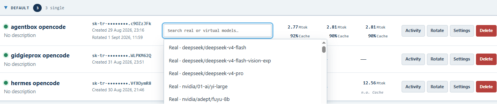
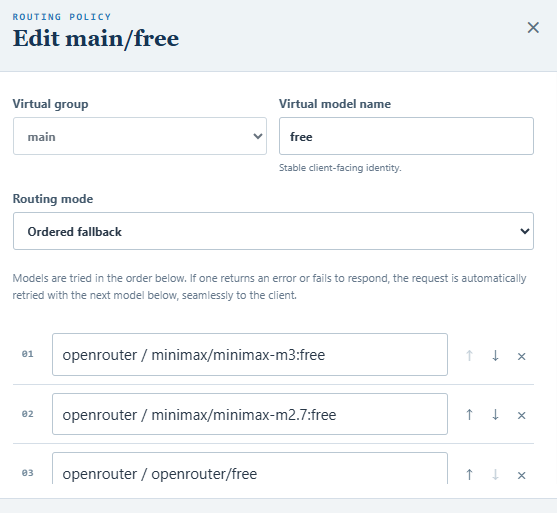
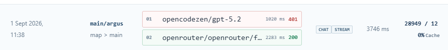

<p align="center">
  
</p>

<h1 align="center">Tiller Router</h1>

<p align="center">
  <strong>One endpoint. One key per client. Steer the models behind it.</strong>
</p>

<p align="center">
  A lightweight, self-hosted LLM router with a control panel built for people who actually change models.
</p>

---

## Why Tiller exists

1. **Every tool had its own (bad) model selector.** Some bury it in settings, some want model IDs in config files, some barely support changing models at all. Tiller moves model selection out of the tool and into one control panel — change it without touching the clients.
2. **Cheap and free API access is useful — until it rate-limits.** Tiller gives virtual models an **ordered fallback chain**, so a limited provider is useful without becoming a single point of failure.
3. **Provider API keys were scattered everywhere.** Enter provider credentials once in Tiller; clients only ever receive a Tiller key.

---

## What Tiller does

Tiller sits between your LLM clients and your upstream providers. Clients keep a stable **endpoint, API key and model name**. You change what sits behind it — a route change applies to new requests immediately. Regardless of what model the client requests, Tiller sends the request to your selected model and the client need know no difference. No restart, no CLI, no config editing. Steer a client key from the control panel by picking any real or virtual model:

<p align="center">
  
</p>

> **Tiller does not try to choose the model for you. It gives you the tiller.**

---

## Client keys

Two client key types cover the two ways tools talk to an LLM API:

### Single — one key, one route

Exposes one stable model identity — usually something simple like `main` — bound to any real or virtual model. The key itself defines the route; and whichever model the client requests will be routed to the provider and model you select in Tiller. Change the route from the web interface and the next request follows it.

### Catalogue — a controlled model list

Exposes a controlled subset of Tiller's catalogue through `GET /v1/models`, with per-client model permissions. Useful to curate exactly which providers and models appear for a client to save wading through hundreds of rows of models you don't use.

---

## Virtual models

A virtual model gives a stable client-facing identity to one or more upstream targets. For example, `main/coding` might resolve to:

```text
1. Z.ai / GLM
2. DeepSeek
3. OpenRouter / Claude
```

The client only knows `main/coding`. You can reorder or replace the targets without changing the client.

Configure the ordered target list in the control panel:

<p align="center">
  
</p>

**Ordered fallback:** if an upstream attempt fails before client-visible output begins, Tiller may try the next configured target — the order you configure is the order Tiller uses.

Each attempt is visible in Activity, including the fallback — the client gets a valid response and never knows there was a failure:

<p align="center">
  
</p>

---

## Supported providers

Tiller includes adapters for a broad set of native and OpenAI-compatible providers.

<details>
<summary><strong>Current provider types</strong></summary>

- OpenAI
- Anthropic
- OpenRouter
- DeepSeek
- Z.ai / GLM
- Google Gemini API
- Azure OpenAI
- Amazon Bedrock API key
- Groq
- Mistral
- xAI
- Together
- Fireworks
- Cerebras
- Perplexity
- NVIDIA NIM
- Hugging Face Inference
- Cloudflare Workers AI
- Alibaba / Qwen
- MiniMax
- OpenCode Zen
- OpenCode Go
- Command Code
- Ollama Local
- Ollama Cloud
- Generic OpenAI-compatible
- vLLM
- LM Studio
- llama.cpp

</details>

Provider support varies because upstream APIs vary. Treat Tiller as **verified for the providers explicitly tested** and compatibility/best-effort for the wider OpenAI-compatible surface.

Notes:

- **Hugging Face Inference:** model discovery always calls `https://huggingface.co/api/models`. A custom base URL changes where inference requests go, not where discovery does, so a mirror configured for inference still sends the token to `huggingface.co` during discovery.

---

## Install

### Option 1 — Prebuilt image (recommended)

1. **Prepare a directory:**

   ```bash
   mkdir tiller-router && cd tiller-router
   ```

2. **Create a `docker-compose.yml`:**

    ```yaml
    services:
      tiller-router:
        image: ghcr.io/dellarb/tiller-router:latest
        ports:
          - "8080:8080"
        volumes:
          - ./data:/data
        restart: unless-stopped
    ```

   `:latest` tracks the newest stable release. To pin a version use `:0.1.0`
   (exact) or `:0.1` (newest `0.1.x` patch). To follow prereleases use `:beta`.

3. **Start Tiller:**

   ```bash
   docker compose up -d
   ```

    Then open `http://localhost:8080`. The first visitor gets a one-time setup page to create the administrator credential (8+ characters) and is signed straight in to a guided onboarding wizard. Once configured, the setup page is gone permanently — sign in from the login screen.

### First steps

1. **Add a provider** — in **Providers**, `+ Add provider`. Choose the type, name the instance, add its API credential. Tiller discovers the model catalogue where supported.

2. **Create a client key** — for the simplest setup: `Type: Single`, `Client model: main`, `Route: main/coding`. Tiller shows the client secret once.

3. **OPTIONAL*** - Create a virtual model - if you want to map different model names or have a fallback chain in case of failure.

4. **Point your tool at Tiller** — for an OpenAI-compatible client: `Base URL: http://localhost:8080/v1`, `API key: <your Tiller client key>`, `Model: main`.

Now steer the real route from Tiller instead of changing the client.

---

### Option 2 — Build from source

```bash
git clone https://github.com/dellarb/tiller-router.git
cd tiller-router
cp .env.example .env   # optionally set TILLER_USERNAME / TILLER_PASSWORD
docker compose up -d --build
```

The repository's `docker-compose.yml` builds locally instead of pulling an image; everything else (healthcheck, adoption-first posture, volumes) is identical to the prebuilt option above.

The service starts as root to self-fix `./data` ownership, then drops to a non-root user before serving.

### Other compose / env options

The repo's `docker-compose.yml` plus `.env` cover the most common local
customisations without editing any Go code. The full list of local variables is
in `.env.example`. `TILLER_USERNAME` / `TILLER_PASSWORD` are optional in local
mode: omit both for first-run setup, set both to skip it. The hosted override
additionally requires the platform credentials below. `TILLER_USERNAME` /
`TILLER_PASSWORD` (or the deprecated `TILLER_ADMIN_*` aliases) are only needed
there when converting an existing local installation:

```bash
TILLER_PLATFORM_ADMIN_USERNAME=platform-admin        # /platform username
TILLER_PLATFORM_ADMIN_PASSWORD=replace-with-a-long-random-password
TILLER_TRUSTED_PROXY=172.20.0.2/32                   # required hosted: direct reverse proxy IP/CIDR
TILLER_PLATFORM_PORT=9443                            # recommended hosted: serve /platform on its own port (see below)
TILLER_USERNAME=owner@example.com                     # optional one-time migration input
TILLER_PASSWORD=existing-local-password               # optional one-time migration input
TILLER_PORT=8080                                     # host port (default 8080)
TILLER_RUN_UID=1000                                  # runtime uid (default 65532)
TILLER_RUN_GID=1000                                  # runtime gid (default 65532)
TILLER_UID=1000                                      # build-time uid for baked-in files (default 65532)
TILLER_GID=1000                                      # build-time gid for baked-in files (default 65532)
TILLER_MODELS_DEV_ENABLED=true                       # models.dev metadata (default true)
TILLER_ADMIN_SESSION_TTL=720h                        # admin session lifetime (default 720h)
TILLER_ADMIN_COOKIE_SECURE=true                     # force Secure on the admin cookie (auto set to true if https used)
TILLER_PUBLIC_URL=https://app.example.com             # required by hosted override
TILLER_INGRESS_NETWORK=proxy_network                 # optional external proxy network
TILLER_INGRESS_NETWORK_EXTERNAL=true                 # set only for a pre-existing network
```

## Advanced

Headless and hosted-operation topics: [docs/management-api.md](docs/management-api.md) covers the management API
(tokens, scopes, quickstart; every instance also serves `/api/admin`, `/api.json`
and `/api/openapi.json`), and [docs/ADVANCED.md](docs/ADVANCED.md) covers
embedding Tiller as another application's LLM gateway, hosted Compose
networking, hosted Google sign-in and Turnstile, and DNS recovery after
restarts.

---

## API example

```bash
# List the models visible to a client key
curl http://localhost:8080/v1/models \
  -H "Authorization: Bearer $TILLER_API_KEY"

# Send a Chat Completions request
curl http://localhost:8080/v1/chat/completions \
  -H "Authorization: Bearer $TILLER_API_KEY" \
  -H "Content-Type: application/json" \
  -d '{
    "model": "main",
    "messages": [
      {
        "role": "user",
        "content": "Say hello from whichever model Tiller is currently pointing at."
      }
    ]
  }'
```

With a Single key, `main` can be redirected from the control panel without changing this request.

### Connect your tools

See the [client integrations guide](docs/client-integrations.md) for SDK examples, client configuration, cURL probes, and reusable application clients.

---

## Design principles

- **Steerable over clever** — if you configure `A → B → C`, Tiller won't decide it prefers `C → A → B` based on an opaque score.
- **Stable clients, movable backends** — the client should know as little as possible about the real provider arrangement.
- **Failure should be boring** — a rate-limited upstream falls through to the next target without turning into an emergency reconfiguration.
- **Keep infrastructure small** — Go, SQLite, one container, few dependencies.
- **Don't collect content you don't need** — Activity answers "what route did this request take?", not "what did it say?". Activity is metadata-only by default. If the administrator explicitly enables Detailed Error Logging, failed request bodies and provider error bodies may be stored, bounded to 1 MiB, and Activity exports containing those records must be treated as sensitive.

---

## Data and security

Tiller stores its state under the configured data directory, normally `./data`. This includes sensitive provider credential material. Core configuration lives in `tiller-router.db` (self-hosted SQLite); high-churn Activity telemetry lives separately in `activity.db` and is disposable — losing it does not affect routing or configuration. Back up `tiller-router.db` (and the master key); `activity.db` can be backed up separately only if Activity history matters. Hosted Tiller is intended to move to PostgreSQL; ordinary self-hosting never requires an external database.

**Recoverable provider credentials are encrypted at rest, always on.** Provider API credentials, OAuth tokens, and the notification auth header are sealed with AES-256-GCM; the master key lives outside the database (`TILLER_MASTER_KEY` / `TILLER_MASTER_KEY_FILE`, or a generated `./data/master.key`). **Back the master key up separately** — without it, existing encrypted credentials cannot be recovered. A database backup does not contain the key; a full `./data` archive does, and must be treated as secret. If encrypted values exist but the key is missing or wrong, Tiller starts in a locked state and credential-bearing providers stay unavailable until the key is restored. Rotate with `tiller-router rotate-master-key` (service stopped). Take care with **where you store `./data`** and any backups of it — keep them on storage you trust.

Client API-key secrets are shown once and stored in hashed form for authentication. Activity is metadata-only by default. If you explicitly enable Detailed Error Logging, failed request bodies and provider error bodies may be stored, bounded to 1 MiB, and Activity exports containing those records must be treated as sensitive.

For anything other than local-only use: use HTTPS, put Tiller behind a trusted reverse proxy, use a strong admin password, protect the data directory and exported backups, and do not expose the control panel casually to the public internet. See [SECURITY.md](SECURITY.md).

**Container posture — hardening is opt-in.** Out of the box the container already runs with a read-only rootfs, a scratch `/tmp` tmpfs, and `no-new-privileges`: it starts as root at boot, self-fixes `./data` ownership, drops to the runtime user, and serves. For internet-exposed deployments you can go further by adding `cap_drop: [ALL]` and forcing a strict non-root `user:` — the repository's `docker-compose.yml` shows the exact commented block. Two rules: `cap_drop ALL` removes the capabilities the boot-time ownership fix needs, so it requires `user:` alongside it; and with `user:` set, the ownership fix is skipped, so `./data` must already exist owned by that user (otherwise startup fails with a logged remediation telling you the expected owner).

---

## Development

Tiller is written in Go with an embedded browser UI and SQLite.

```bash
go test ./...
go vet ./...
go build ./cmd/tiller-router
docker compose build
```

The project currently targets the Go version declared in `go.mod`.

---

## Project status

Tiller Router is at **0.1**, its first stable release, after ten public betas. The routing model is intentionally narrow and already useful. Because the version is still `0.x`, the public API, migrations and provider compatibility surface may change between minor releases before `1.0`; the [changelog](CHANGELOG.md) calls out breaking changes and upgrade steps. The near-term priority is still reliability and hardening.

Likely areas for upcoming `0.x` releases include: additional provider validation, richer provider health, cost-aware routing, additional capability metadata, experimental subscription-backed providers such as Codex, and further hardening and operational polish.

---

## Contributing

Issues and pull requests are welcome. The project intentionally favours a small, understandable core — new features are most useful when they strengthen Tiller's central job:

> **Make LLM clients easy to steer without making the router itself complicated.**

See [CONTRIBUTING.md](CONTRIBUTING.md).

---

## Licence

See [LICENSE](LICENSE).
